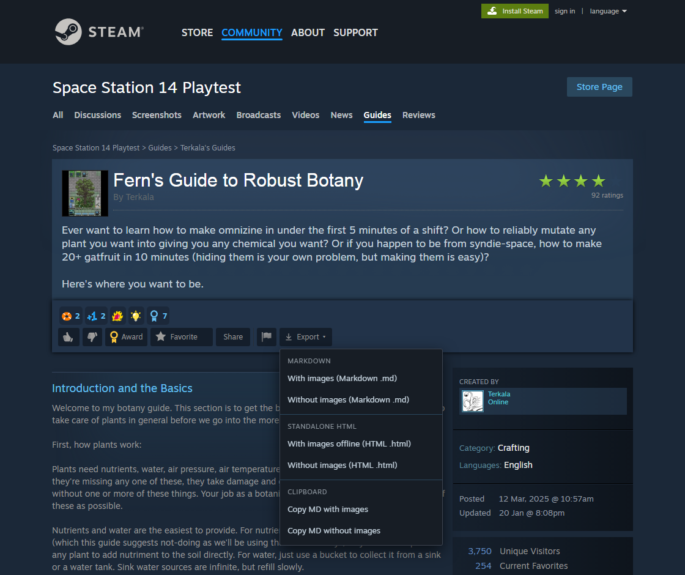
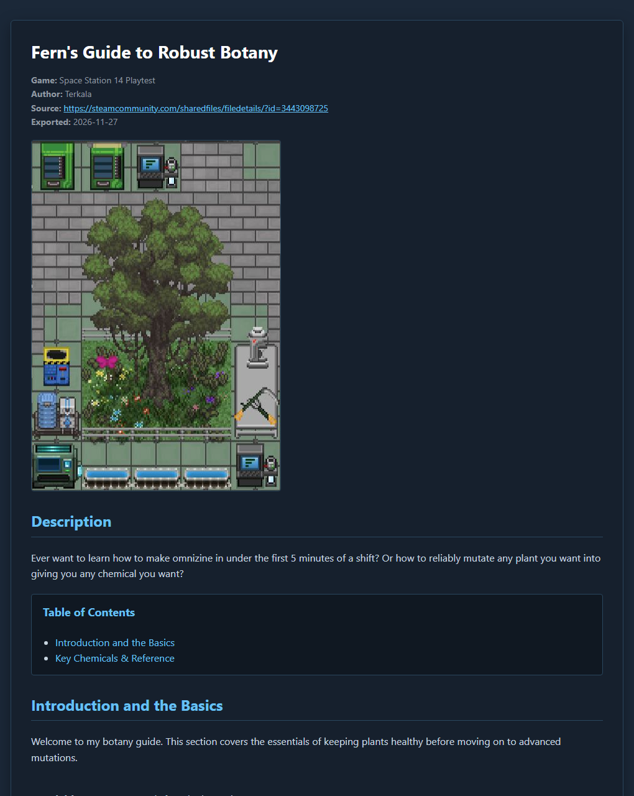

<div align="center">

# Steam Guide Exporter

[](README.md)
[](README.ru.md)
[](LICENSE)

**Экспорт любых руководств Сообщества Steam в Markdown (`.md`) или автономный офлайн HTML (`.html`) — с картинками и без.**

[](https://raw.githubusercontent.com/IffyChan/steam-guide-exporter/main/steam-guide-exporter.user.js)

</div>

---

## Скриншоты

### Нативная кнопка экспорта и меню в Steam


### Экспортированный автономный HTML


## Возможности

- **Нативная интеграция в интерфейс Steam**: добавляет кнопку **«Экспорт ▾»** прямо в панель действий (`#ItemControls`) и активируется только на страницах руководств.
- **Две вариации экспорта**:
  - **С картинками**: экспортирует обложку и все встроенные изображения в полном разрешении (автоматически удаляются параметры обрезки Steam UGC `imw`, `imh`, `letterbox`).
  - **Без картинок**: полностью вырезает обложку, все теги `` и обёртки `.modalContentLink` без пустых ссылок.
- **Поддерживаемые форматы**:
  - **Markdown (`.md`)** — с полноразмерными ссылками на изображения или чистым текстом.
  - **Автономный HTML (`.html`)** — один файл в тёмной теме Steam; в режиме *с картинками* изображения загружаются через `GM_xmlhttpRequest` и встраиваются в Base64 `data:` URI для чтения офлайн.
  - **Буфер обмена** — быстрое копирование Markdown с картинками или без них.
- **Полная поддержка BBCode Steam**: заголовки (`.bb_h1`–`.bb_h3`), списки, таблицы (`.bb_table`, включая ячейки `.bb_table_th` без строки-обёртки), цитаты, блоки кода, спойлеры, встроенные видео и безопасная очистка ссылок от `linkfilter`.
- **Автоопределение языка**: интерфейс кнопки и меню автоматически переключается между русским и английским в зависимости от языка страницы Steam.

## Установка

1. Установите расширение [Tampermonkey](https://www.tampermonkey.net/) или [Violentmonkey](https://violentmonkey.github.io/).
2. Нажмите кнопку **«Установить»** выше (или откройте напрямую [steam-guide-exporter.user.js](https://raw.githubusercontent.com/IffyChan/steam-guide-exporter/main/steam-guide-exporter.user.js)).
3. Откройте любое руководство Steam, например [Fern's Guide to Robust Botany](https://steamcommunity.com/sharedfiles/filedetails/?id=3443098725).
4. Нажмите **«Экспорт ▾»** рядом с «В избранное» / «Поделиться» и выберите нужную вариацию.

## Разработка и тестирование

Без внешних зависимостей. Требуется Node.js 18+.

```bash
node --check steam-guide-exporter.user.js
node --test test/exporter.test.js
```

## Лицензия

[MIT](LICENSE)
